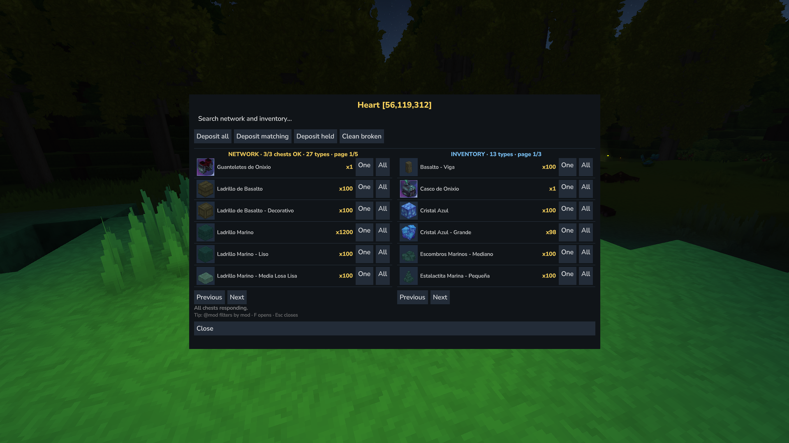
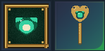
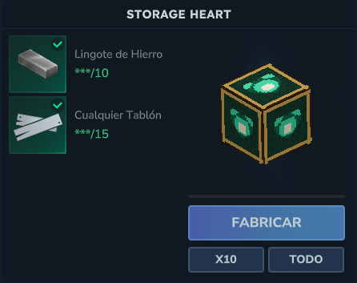
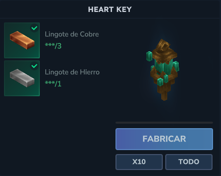

# StorageHeart — central storage for Hytale

Unified access to your whole chest network from a single block, inspired by
Terraria's **Magic Storage** Storage Heart. No commands: everything works
with items (Heart + Key) and F (Ctrl+F with the Key to unlink).




## Usage

1. Craft the **Storage Heart** and the **Heart Key** at the workbench
   (crafting tab), or grab them from the creative inventory.
2. Place the Heart and press **F with the Key in hand** on it: link mode ON.
3. Press **F with the Key** on each chest (within 32 blocks of the Heart).
4. Press **F with the Key** on the Heart again to finish link mode.
5. Press **F with an empty hand** on the Heart to open the interface:
   NETWORK column (take with One/All) and INVENTORY column (store with
   One/All), name search (accents optional, `@mod` filters by mod),
   Deposit all / matching / held, Clean broken (press twice to confirm).
6. To unlink a chest: **Ctrl+F with the Key** on it (works from any
   network). With no link mode active, F with the Key on a chest simply
   opens the chest as vanilla.
   Close: F (like a vanilla chest), Close button, or Esc.

Items are stored with their real data: custom names, durability, quality
and metadata are preserved when you take them back (a damaged sword stays
damaged). Opening the Heart shows only the StorageHeart interface; the
vanilla 9-slot chest window is cancelled before it can appear. The interface
uses Hytale's container frame, close X, input box and button styles.

## Crafting (workbench, no knowledge required)

| Item | Ingredients |
|---|---|
| Storage Heart | 10× iron bar + 15× planks (any wood) |
| Heart Key | 3× copper bar + 1× iron bar |



|  |  |

## Requirements

- Hytale server **0.7.2** (manifest `ServerVersion: "=0.7.2"`, compiled against
  `Server-0.7.2.jar`)
- Java 25 to compile

## Limits

- 32 blocks between the Heart and each chest.
- 32 chests per network by default (configurable in `config.json`).
- Interface actions are only accepted within 10 blocks of the Heart; if you
  walk away, the page closes.

## Multiplayer note

The Heart has no owner or permission system: anyone who can reach it can open
the interface and take from the network. Use it on trusted servers, or
protect the area with your server's world/land permissions. Ownership and
per-network locks are planned for a future version.

## Build and package

```powershell
cd storage-heart
.\build.ps1 -ServerJar 'C:\path\to\Server-0.7.2.jar'
# jar lands in dist/StorageHeart-<version>.jar
```

Copy the jar into the world's (or server's) `mods/` folder **with the game
closed** (a single `StorageHeart-*.jar` only) and check that the SHA256
matches the build output.

## Layout

```
src/main/java/com/storageheart/
  StorageHeartPlugin.java   lifecycle + F events
  StorageHeartConfig.java   config (ids, distances)
  StorageNetworkService.java  player-inventory adapter
  core/                     pure logic, no Hytale imports
  link/                     links, network over real chests
  ui/StoragePage.java       custom UI (search, dual column)
src/main/resources/
  manifest.json             manifest (ServerVersion "=<v>" exactly)
  Common/UI/Custom/         StorageHeartPage.ui + Pages/StorageHeartRow.ui
  Server/Item/Items/StorageHeart/  Heart + Key (block, item, recipes)
```

Architecture rule: `core/` never imports `com.hypixel.*`; all Hytale API
lives in adapters (`link/`, `ui/`).

## License

MIT — see [LICENSE](LICENSE).
